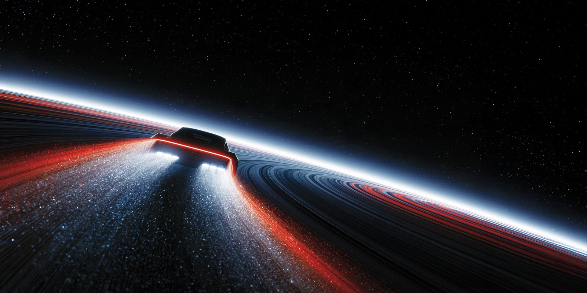

# To Beyond

A dark Omarchy / Omalauncher theme: near-black space, icy blue text, and vivid red accents.



## Wallpapers

All artwork is by Dogan Ural. Vertical slices are stitched side by side in post order, without cropping or gaps.

| Background | Size | Source |
| --- | --- | --- |
| To Beyond (default) | 8192 × 4096 | [Original post](https://x.com/doganuraldesign/status/2110745483547206034) |
| Alternate rings | 8192 × 4096 | [Original post](https://x.com/doganuraldesign/status/2107499209427665080) |
| Stardust / Is this true? | 4096 × 2293 | [Original post](https://x.com/doganuraldesign/status/2075231325133439120) |
| Generational Inspiration / Tesla Roadster | 8192 × 4096 | [Original post](https://x.com/doganuraldesign/status/2110977797875257717) |

To Beyond, Alternate rings, and Generational Inspiration each combine four vertical slices into one horizontal image. Stardust is a single landscape image. The original To Beyond wallpaper remains the default.

The artwork belongs to its original creator. No artwork license or endorsement is implied.

## Install

```sh
omarchy theme install https://github.com/cbarland/omarchy-to-beyond-theme
```


Clone or extract this theme into `~/.config/omarchy/themes/to-beyond`, then select **To Beyond** in the launcher’s theme picker. Choose its stitched wallpaper under Background.

Includes `colors.toml`, `icons.theme`, and four wallpapers. Terminal colors are generated by Omarchy from the palette.

## License

The palette and theme configuration are MIT licensed. Wallpaper artwork and derived preview images are excluded from that license and remain the property of Dogan Ural. Redistribution permission has not been confirmed.
